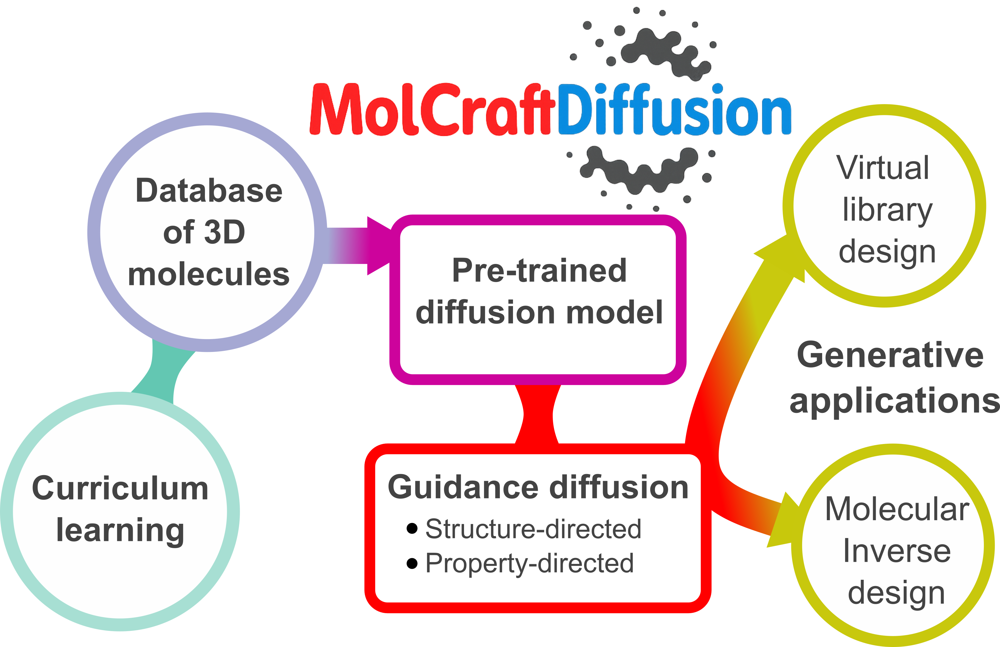

<p align="center">
  
</p>

<p align="center">
  <a href="https://pypi.org/project/molcraftdiffusion/"></a>
  <a href="https://pubs.acs.org/doi/10.1021/jacs.5c19960"></a>
  <a href="https://doi.org/10.5281/zenodo.19511401"></a>
  <a href="https://huggingface.co/pregH/MolecularDiffusion"></a>
  <a href="https://huggingface.co/pregH/MolecularDiffusion"></a>
  <a href="https://preghosh.github.io/MolCraftDiffusion/"></a>
  <a href="https://github.com/lcmd-epfl/AutomaticMolCraft"></a>
</p>

---

Three-dimensional molecular generative models place atoms directly in Cartesian space, enabling geometric and physicochemical conditioning. Yet their implementations and evaluation workflows remain fragmented across incompatible repositories.

**One platform brings together a broad range of 3D molecular generators for de novo, property-directed, structure-guided, shape-conditioned, pocket-conditioned, fragment-based, and pharmacophore-driven design.**

MolCraftDiffusion unifies data preparation, training and fine-tuning, guided generation, checkpoint handling, and evaluation behind a modular architecture and consistent CLI. This shared workflow makes diverse generators easier to build, compare, and apply across virtual library construction, chemical-space exploration, inverse design, and structure-based discovery. A no-code browser UI, [AutomaticMolCraft](https://github.com/lcmd-epfl/AutomaticMolCraft), is also available for users who prefer not to work from the CLI.

<p align="center">
  
</p>

## One Platform, Many 3D Generation Paradigms

- **De novo generation** of complete 3D molecules
- **Property-directed generation** for inverse molecular design
- **Structure-guided generation** through inpainting, outpainting, and soft reference steering
- **Shape-conditioned generation** around desired molecular geometries
- **Protein-pocket-conditioned generation** for structure-based molecular design
- **Fragment linking and scaffold elaboration**
- **Pharmacophore-conditioned generation**
- **Latent-space diffusion and flow-matching approaches**

These capabilities share the same configuration system, CLI, data pipeline, checkpoint handling, and analysis tools, making it possible to apply and compare different generation paradigms without maintaining separate codebases. See the [supported architectures and their application domains](https://preghosh.github.io/MolCraftDiffusion/architectures.html).

## Features

| | |
|---|---|
| **Broad generator coverage** | Multiple 3D generation paradigms and application domains in one platform |
| **3D-native generation** | Models trained directly in Cartesian space; geometric validity by construction, not augmentation |
| **Extensible architecture** | Multiple backbone families included; adding a new model is a single sub-package drop-in |
| **Steerable generation** | Guide outputs towards target properties or structural constraints without retraining |
| **End-to-end pipeline** | Raw data through training to post-generation analysis, with no glue scripts needed |
| **Unified CLI** | `train · generate · predict · analyze · data`, all from one `MolCraftDiff` entry point |
| **Built-in analysis suite** | Geometry optimisation, validity metrics, quantum-chemical descriptors, and featurisation |

## Installation

```bash
# Create environment
conda create -n molcraft python=3.11 -y
conda activate molcraft
```

**GPU / CUDA:**
```bash
pip install molcraftdiffusion[gpu] \
    --find-links https://data.pyg.org/whl/torch-2.6.0+cu124.html
```

**CPU-only:**
```bash
pip install molcraftdiffusion[cpu] \
    --extra-index-url https://download.pytorch.org/whl/cpu \
    --find-links https://data.pyg.org/whl/torch-2.6.0+cpu.html
```

**macOS (Apple Silicon, MPS GPU):** from a clone, `pip install -e '.[mac]' && pip install ./mac_shims`. See the [macOS section of the installation guide](https://preghosh.github.io/MolCraftDiffusion/installation.html#macos-apple-silicon).

See the [installation guide](https://preghosh.github.io/MolCraftDiffusion/installation.html) for optional capabilities, platform-specific dependencies, and development setup.

## Usage

Pre-trained diffusion models are available on [Hugging Face](https://huggingface.co/pregH/MolecularDiffusion). Starting from a pretrained checkpoint is recommended for downstream tasks.

### Model zoo

Pretrained weights, datasets and runnable example configs for every integrated
model are resolved **by name** rather than by path, so an example config runs
unchanged on any machine:

```bash
MolCraftDiff zoo list                        # what is available
MolCraftDiff zoo fetch --model kgdiff        # pulls only what that model needs
MolCraftDiff generate examples/kgdiff_generate.yaml
```

Assets are cached under `$MOLCRAFT_ASSETS` (default `~/.cache/molcraft/zoo`)
and verified by sha256 on every fetch. The zoo repositories are currently
private — access requires a HuggingFace token with permission. See the
[quickstart tutorial](https://preghosh.github.io/MolCraftDiffusion/tutorials/quickstart_model_zoo.html)
for the full command reference.

### CLI

Training and inference commands accept a YAML config followed by optional Hydra-style overrides:

```
MolCraftDiff {train|generate|predict|eval-predict} CONFIG [key=value ...]
```

Analysis and data preparation are direct utility command groups, while generation sweeps accept a sweep config and command-line options.

| Command | Description |
|---|---|
| `train` | Train a diffusion, regression, or guidance model |
| `generate` | Sample molecules from a trained model |
| `generate-sweep` | Run and resume generation parameter sweeps |
| `predict` | Run property prediction |
| `eval-predict` | Evaluate prediction results |
| `analyze` | Post-process and evaluate generated molecules |
| `data` | Data preparation and augmentation utilities |

```bash
MolCraftDiff train configs/example_diffusion_config.yaml
MolCraftDiff generate configs/generate.yaml interference.num_generate=100
MolCraftDiff predict configs/predict.yaml
MolCraftDiff generate-sweep path/to/sweep.yaml --dry-run
MolCraftDiff data prepare compile -s data_dir/ -d dataset.db

MolCraftDiff --help         # all commands
MolCraftDiff train --help   # per-command help
```

### Web interface

Prefer a browser to a CLI? [AutomaticMolCraft](https://github.com/lcmd-epfl/AutomaticMolCraft) is a no-code web UI built on top of MolCraftDiffusion — property-guided generation, structure-guided inpainting/outpainting, training configuration, dataset curation, and linked 2D/3D visualization, all through a local server (`dev.sh`).

### Analysis & Post-processing

```bash
MolCraftDiff analyze metrics generated_molecules/
MolCraftDiff analyze --help
```

The analysis suite covers structural validation, geometry optimisation and comparison, electronic properties, molecular representations, feature extraction, and structure-based drug-design checks: library docking into a fixed pocket (`analyze dock`, `analyze bias`, with MD and MM-GBSA practice in [`docs/drug_design/`](./docs/drug_design)). See the [analysis tutorial](https://preghosh.github.io/MolCraftDiffusion/tutorials/09_analyze.html) for commands and optional dependencies.

## Tutorials and Tests

Twelve step-by-step tutorials ship with the repository in
[`docs/tutorials/`](./docs/tutorials), covering data preparation, training a
diffusion model, regressors, guidance models, fine-tuning, generation,
structure-guided and property-directed sampling, sweeps, evaluation and
analysis. Each is self-contained, with the commands and the configuration
inline, and the templates they copy from are in [`configs/`](./configs). They
are also rendered in the
[documentation](https://preghosh.github.io/MolCraftDiffusion/tutorials/index.html).

The automated test suite is separate, in [`tests/`](./tests), and is run with
`just check`.

## Documentation

- [Installation](https://preghosh.github.io/MolCraftDiffusion/installation.html)
- [Supported architectures and application domains](https://preghosh.github.io/MolCraftDiffusion/architectures.html)
- [Tutorials](https://preghosh.github.io/MolCraftDiffusion/tutorials/index.html)
- [Configuration templates](https://preghosh.github.io/MolCraftDiffusion/config_templates.html)

## Data and Trained Models

The datasets, trained checkpoints and configuration files behind each paper are
archived on Zenodo. Each record is citable by its own DOI and is linked to the
corresponding publication.

| Archive | Contents | Paper |
|---|---|---|
| [10.5281/zenodo.19511401](https://doi.org/10.5281/zenodo.19511401) | `data.zip`, `models.zip`, `cfg_examples.zip` for every experiment in the platform paper | [Modular Framework for 3D Molecular Generation](https://pubs.acs.org/doi/10.1021/jacs.5c19960) |
| [10.5281/zenodo.20829155](https://doi.org/10.5281/zenodo.20829155) | `data.zip`, `models.zip` for the augmented and annotated training sets and the conditioned diffusion models | [A Diffusion Framework for Geometrically Valid and Practically Viable 3D Molecular Generation](https://chemrxiv.org/doi/full/10.26434/chemrxiv.15005231/v1) |

Model weights and datasets are also mirrored on
[Hugging Face](https://huggingface.co/pregH/MolecularDiffusion).

## Project Structure

```
src/MolecularDiffusion/
├── cli/                         # Shared command-line entry points
├── configs/
│   ├── tasks/<generator>.yaml   # Hydra registration for a generator
│   └── ...                      # Shared data, trainer, engine, and generation configs
├── core/                        # Architecture-agnostic training engines and callbacks
├── data/                        # Shared datasets, loaders, and molecular representations
├── modules/
│   ├── layers/<family>/         # Optional reusable architectural building blocks
│   ├── models/<generator>/      # Isolated model implementation
│   └── tasks/<generator>.py     # Thin adapter to the common task interface
├── runmodes/                    # Generic training, generation, and analysis workflows
└── utils/                       # Geometry, diffusion, graph, and I/O utilities
```

Adding a generator normally requires only its isolated model implementation, a task adapter, and a Hydra task config. The shared CLI, data pipeline, training engines, checkpoint handling, and analysis workflows remain unchanged because they operate through a common task interface.

## Citation

If you use MolCraftDiffusion in your research, please cite:

### MolCraftDiffusion

[](https://pubs.acs.org/doi/10.1021/jacs.5c19960)

[Modular Framework for 3D Molecular Generation in Computational Chemistry Applications](https://pubs.acs.org/doi/10.1021/jacs.5c19960)

```bibtex
@article{worakul_modular_2026,
	title = {Modular {Framework} for {3D} {Molecular} {Generation} in {Computational} {Chemistry} {Applications}},
	copyright = {https://creativecommons.org/licenses/by/4.0/},
	issn = {0002-7863, 1520-5126},
	url = {https://pubs.acs.org/doi/10.1021/jacs.5c19960},
	doi = {10.1021/jacs.5c19960},
	language = {en},
	urldate = {2026-06-24},
	journal = {Journal of the American Chemical Society},
	author = {Worakul, Thanapat and Azzouzi, Mohammed and Wodrich, Matthew D. and Corminboeuf, Clémence},
	month = jun,
	year = {2026},
	pages = {jacs.5c19960},
}
```

### Related Paper

[](https://chemrxiv.org/doi/full/10.26434/chemrxiv.15005231/v1)

[A Diffusion Framework for Geometrically Valid and Practically Viable 3D Molecular Generation](https://chemrxiv.org/doi/full/10.26434/chemrxiv.15005231/v1)

```bibtex
@article{worakul_diffusion_2026,
	title = {A {Diffusion} {Framework} for {Geometrically} {Valid} and {Practically} {Viable} {3D} {Molecular} {Generation}},
	url = {https://chemrxiv.org/doi/full/10.26434/chemrxiv.15005231/v1},
	doi = {10.26434/chemrxiv.15005231/v1},
	publisher = {American Chemical Society (ACS)},
	author = {Worakul, Thanapat and Corminboeuf, Clémence},
	month = jun,
	year = {2026},
}
```

[](https://chemrxiv.org/doi/abs/10.26434/chemrxiv.15008080/v1)

[AutomaticMolCraft: A Web Interface for 3D Molecular Generation, Dataset Curation, and Structure–Property Analysis](https://chemrxiv.org/doi/abs/10.26434/chemrxiv.15008080/v1)

```bibtex
@article{worakul_automaticmolcraft_2026,
	title = {{AutomaticMolCraft}: {A} {Web} {Interface} for {3D} {Molecular} {Generation}, {Dataset} {Curation}, and {Structure}–{Property} {Analysis}},
	url = {https://chemrxiv.org/doi/abs/10.26434/chemrxiv.15008080/v1},
	doi = {10.26434/chemrxiv.15008080/v1},
	publisher = {American Chemical Society (ACS)},
	author = {Worakul, Thanapat and Hernandez Cuellar, Osvaldo and Corminboeuf, Clémence},
	month = aug,
	year = {2026},
}
```

